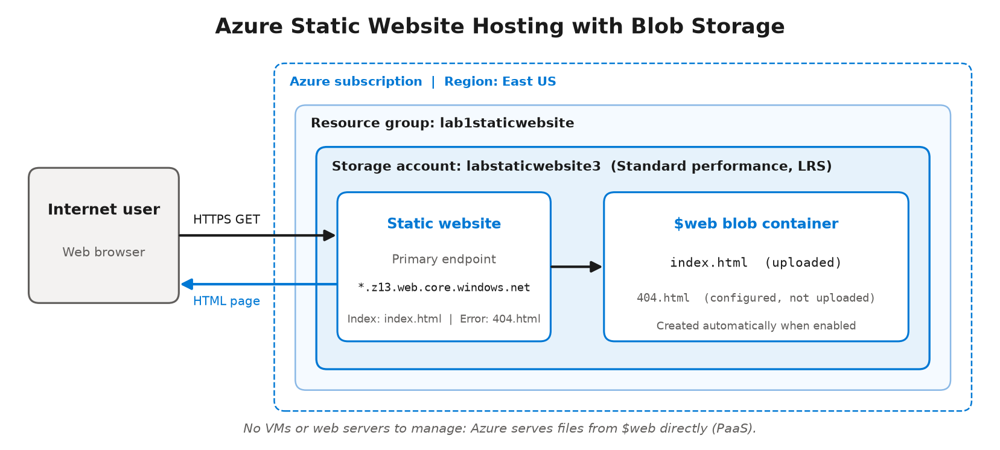
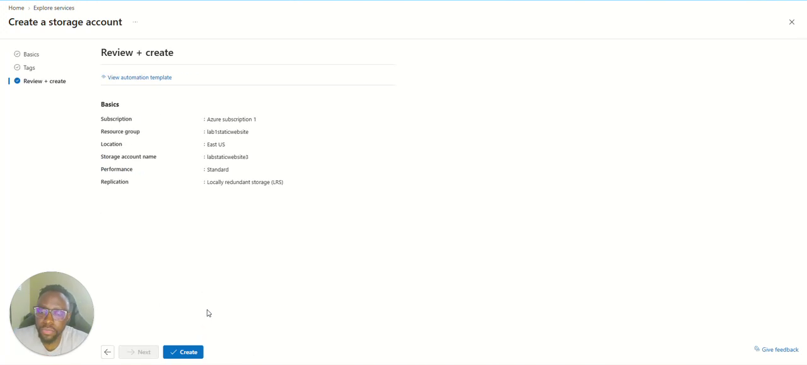
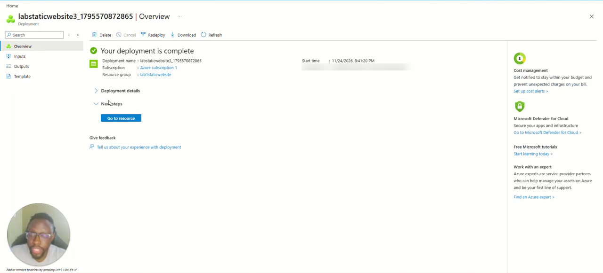
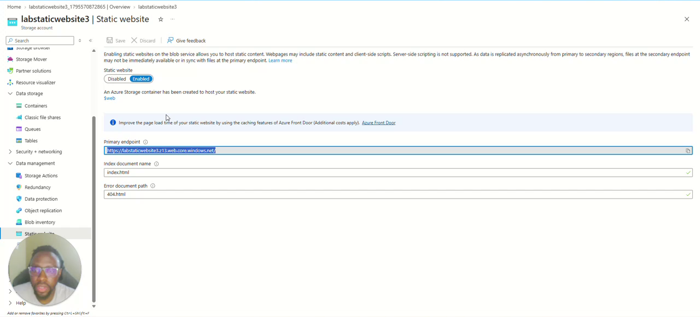
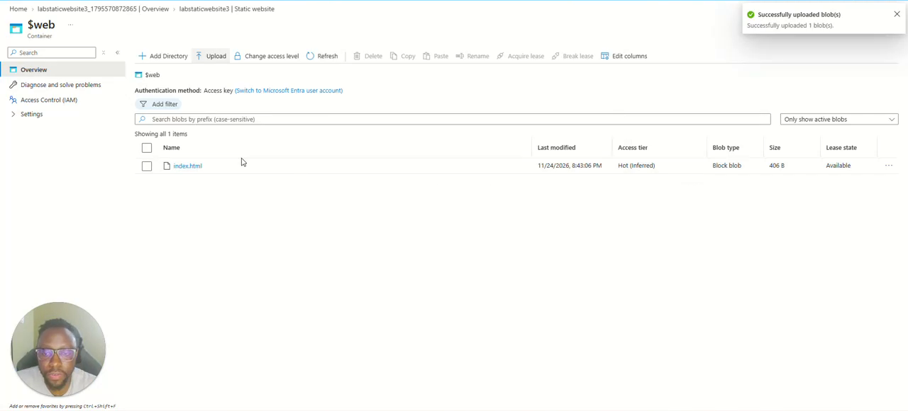
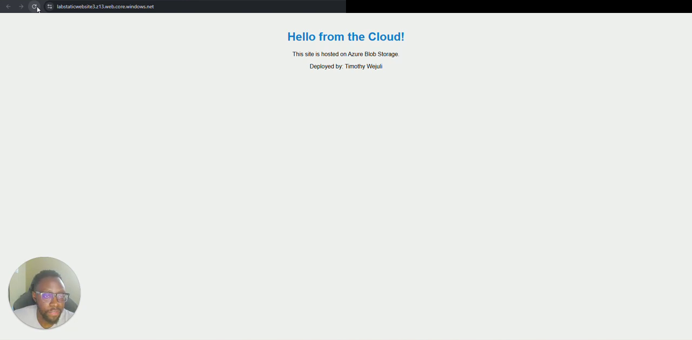

# Azure Static Website Hosting with Blob Storage

Hosting a public website on Azure **without a single server**, using **Azure Blob Storage static website hosting** (PaaS).

**Video walkthrough:** [Building a Static Website with Azure Blob Storage (Loom, about 2.5 minutes)](https://www.loom.com/share/279edbc7aeb345e38c348704a3ba55b2)



## The Business Problem This Lab Solves

Many teams need a simple public web presence (a landing page, documentation, a status page, or a marketing microsite) but don't need a full web server. Running a VM for static content means patching an operating system, configuring a web server, managing uptime, and paying for compute that sits idle most of the day.

That overhead is a real cost for a small team: time spent maintaining infrastructure instead of the content customers actually see.

This lab shows the alternative: let **Azure serve static files directly from Blob Storage**. There's no OS to patch and no web server to configure, and the only cost is storage and bandwidth.

## How This Lab Solves It

| Business challenge | Solution in this lab | Proof |
|---|---|---|
| Avoid managing servers for simple web content | **Static website hosting** enabled on a **Standard, LRS** storage account | [Static website enabled with a primary endpoint](screenshots/03-static-website-enabled.png) |
| Keep lab and hosting costs low | **Locally redundant storage (LRS)** with **Standard** performance, the lowest-cost option | [Review + create summary](screenshots/01-review-create-storage-account.png) |
| Organize resources so they're easy to track and remove | All resources deployed into one dedicated **resource group** (`lab1staticwebsite`) | [Deployment complete](screenshots/02-deployment-complete.png) |
| Publish content without deploying code to a server | Uploaded `index.html` to the auto-created **`$web`** container | [index.html in $web](screenshots/05-index-uploaded-to-web-container.png) |
| Confirm the site is actually reachable by users | Browsed to the public endpoint before and after upload | [404 before upload](screenshots/04-404-before-upload.png) → [live site after upload](screenshots/06-live-static-website.png) |

## Environment

| Setting | Value used |
|---|---|
| Region | East US |
| Resource group | `lab1staticwebsite` |
| Storage account | `labstaticwebsite3` |
| Performance / redundancy | Standard / LRS |
| Index document | `index.html` |
| Error document path | `404.html` |
| Tools | **Azure Portal**, **Azure Blob Storage**, **HTML** |

## Build Walkthrough

### 1. Create the storage account

Created a storage account in **East US** inside the `lab1staticwebsite` resource group, with **Standard** performance and **LRS** redundancy to keep costs at a minimum.



The Review + create summary confirms the region, resource group, account name, performance tier, and LRS redundancy before deployment.



Azure confirms the deployment completed. Next step: **Go to resource**.

### 2. Enable static website hosting

Under **Data management → Static website**, switched hosting from Disabled to **Enabled**, set the index document to `index.html` and the error document path to `404.html`, then saved.



After saving, Azure generated the **primary endpoint** (`https://labstaticwebsite3.z13.web.core.windows.net/`) and automatically created the **`$web`** container that the site is served from.

### 3. Test the endpoint before uploading content

Opened the primary endpoint before uploading any files.


The endpoint returned **HTTP 404 – WebContentNotFound**. That result is useful: it proves the endpoint is live and publicly reachable, and that the only thing missing is content. Because no `404.html` was uploaded, Azure showed its default error page instead of a custom one.

### 4. Upload the website file to `$web`

Opened **Containers → $web** and uploaded [`site/index.html`](site/index.html).



Azure confirms the upload: `index.html` is in `$web` as a block blob (406 B, Hot tier).

### 5. Validate the live site

Refreshed the primary endpoint in the browser.



The page now renders "Hello from the Cloud!", served directly from Blob Storage over HTTPS with no VM or web server involved.

### 6. Clean up (run when finished)

To avoid ongoing charges, delete the whole resource group:

1. Go to **Resource groups → lab1staticwebsite**.
2. Click **Delete resource group**, type the name to confirm, and click **Delete**.

Or with the Azure CLI:

```bash
az group delete --name lab1staticwebsite --yes --no-wait
```

## Troubleshooting

| Symptom | Cause | Fix |
|---|---|---|
| `404 – The requested content does not exist` | No `index.html` in `$web` yet (seen in step 3), or the file was misnamed or put in the wrong container | Upload a file named exactly `index.html` (case-sensitive) to `$web` |
| Default Azure 404 page instead of a custom one | `404.html` is configured but was never uploaded | Upload a `404.html` to `$web` |

## Skills Demonstrated

- **Azure PaaS** concepts: serving content without managing infrastructure
- **Azure Storage** account configuration (performance tiers, redundancy options)
- **Static website hosting** and the `$web` container model
- **Resource group** organization for lifecycle and cleanup
- **Validation-first troubleshooting**: interpreting a 404 to confirm the endpoint was live before adding content
- Technical documentation with screenshot-backed evidence

## What I'd Improve Next

- **Upload a custom `404.html`** so users see a branded error page instead of Azure's default.
- **Use a consistent naming convention** (e.g., `rg-lab01-*`, `stlab01*`) and **add tags** (owner, environment, cost center) for cost tracking.
- **Rebuild it with Terraform** so the storage account and static website configuration are repeatable and versioned.
- **Automate deployment with GitHub Actions** so a push to `main` uploads site changes to `$web`.
- **Add a custom domain and Azure Front Door or CDN** for caching, custom-domain HTTPS, and better global performance.
- **Set a budget alert** on the subscription.

## Repository Structure

```
.
├── README.md
├── diagrams/
│   ├── architecture.png      # Architecture diagram
│   └── architecture.py       # Script that generates the diagram
├── screenshots/              # Evidence captured from the walkthrough video
└── site/
    └── index.html            # Website file uploaded to $web
```
